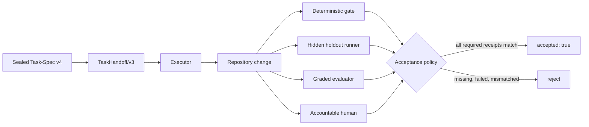

# Evaluation policy

Format v3 answers: “Did the declared checks pass, within the declared scope,
without changing the authorized contract?” Format v4 adds: “Which independent
forms of evidence must exist before that result may be accepted?”

The distinction matters because different claims need different referees.
Compilers and tests are excellent at deterministic behavior. A hidden holdout
can detect overfitting to visible checks. A rubric can assess bounded qualities
that are not binary. A named human remains responsible for meaning, risk, or
policy decisions that data and code cannot own.

The executor sees the policy, not the private evaluator implementation:

Pin the holdout before the task is authorized. There are two ways, and either
ties the receipt to what the owner approved:

- **The bundle:** put the digest of the bundle file in
  `evaluation_policy.holdout.authorization_ref` (`sha256:<hex>`). The holdout
  runner writes the digest of the bundle it ran into the receipt
  (`bundle_digest`), and acceptance refuses a receipt that names another bundle
  or none. The bundle digest is known as soon as the bundle is written.
- **The descriptor:** seal the bundle first, then put the digest of the
  descriptor file in `evaluation_policy.holdout.descriptor_digest`. Acceptance
  refuses a receipt for any other descriptor.

Seal the descriptor with a key the executor never sees
(`TASKSPEC_HOLDOUT_KEY`); the runner then refuses an unsealed descriptor.

In `local` scope a receipt is an unsigned statement, and anyone who holds the
handoff can write one. The pin protects against the wrong bundle being run, not
against a forged receipt. Forgery resistance comes from `portable` or
`human-authorized` scope, where every receipt must carry the signature of an
evaluator in the trust registry.

Use `local` when evidence is meaningful only in the current checkout. Use
`portable` when another environment must reproduce it; this requires an
environment contract. Use `human-authorized` when human acceptance is the
dominant final boundary.
